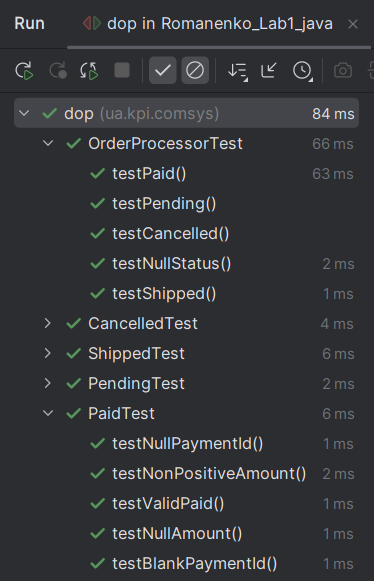
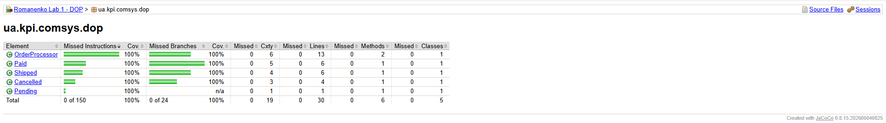

# Лабораторна робота №1

**Дисципліна:** Розробка програмного забезпечення на платформі Java (2026)

**Тема:** Сучасні можливості Java та підхід Data-Oriented Programming (DOP)

**Мета:** Навчитися моделювати незмінні дані за допомогою Records та Sealed Types, розділяти дані й алгоритми, реалізовувати бізнес-логіку через Switch Expressions та Pattern Matching, а також використовувати Text Blocks.

**Виконав:** Романенко Іван Євгенович

**Група:** ІО-45


## Мета роботи

Навчитися моделювати незмінні дані за допомогою `record` і `sealed interface`, відокремлювати дані від алгоритмів відповідно до підходу Data-Oriented Programming, застосовувати `switch` expressions з pattern matching і форматувати результати за допомогою Text Blocks.

## Визначення варіанта

Варіант визначається остачею від ділення номера залікової книжки на 3.

- Номер залікової книжки: **4509**.
- Формула: `V = N mod 3`.
- Обчислення: `4509 mod 3 = 0`.

**Варіант 0 — система управління замовленнями.**

## Опис реалізації

Проєкт моделює чотири стани замовлення через `sealed interface OrderStatus` і публічні незмінні записи (`record`):

| Тип | Призначення | Дані |
|---|---|---|
| `Pending` | Замовлення очікує обробки | Додаткових полів немає |
| `Paid` | Замовлення оплачено | `paymentId`, `amount` |
| `Shipped` | Замовлення відправлено | `trackingCode`, `dispatchDate` |
| `Cancelled` | Замовлення скасовано | `reason` |

Усі типи розташовано в пакеті `ua.kpi.comsys.dop`. У конструкторах записів `Paid`, `Shipped` і `Cancelled` перевіряються обов'язкові значення та допустимість даних. Некоректні дані спричиняють `IllegalArgumentException`.

Бізнес-логіку винесено до класу `OrderProcessor`, метод `process(OrderStatus status)` якого:

- відхиляє `null` винятком `IllegalArgumentException("Status cannot be null")`;
- використовує вичерпний `switch` expression із pattern matching для всіх чотирьох типів, без `default`;
- повертає повідомлення у форматі, заданому методичкою, використовуючи Java Text Blocks.

Приклад обробки оплаченої заявки:

```java
import java.math.BigDecimal;

OrderProcessor processor = new OrderProcessor();
Paid status = new Paid("PAY123", new BigDecimal("250.50"));
System.out.print(processor.process(status));
```

Вивід:

```text
Order Status: PAID
Details: Payment ID: PAY123, Amount: $250.50
```


## Структура проєкту

```text
Romanenko_Lab1_java/
├── docs/
│   └── images/
│       ├── junit-tests.png
│       └── jacoco-coverage.png
├── src/
│   ├── main/java/ua/kpi/comsys/dop/
│   │   ├── OrderStatus.java
│   │   ├── Pending.java
│   │   ├── Paid.java
│   │   ├── Shipped.java
│   │   ├── Cancelled.java
│   │   └── OrderProcessor.java
│   └── test/java/ua/kpi/comsys/dop/
│       ├── PendingTest.java
│       ├── PaidTest.java
│       ├── ShippedTest.java
│       ├── CancelledTest.java
│       └── OrderProcessorTest.java
├── pom.xml
├── .gitignore
└── README.md
```

## Середовище та технології

- **Java:** JDK 25; цільовий рівень компіляції — Java 21 (`maven.compiler.release=21`).
- **Система збирання:** Apache Maven.
- **Тестування:** JUnit Jupiter 5.11.4.
- **Покриття:** JaCoCo Maven Plugin 0.8.15.
- **Середовище розробки:** IntelliJ IDEA.
- **Контроль версій:** Git.

## Запуск перевірок

Для виконання тестів потрібні JDK 21 або новіший і Maven. Із кореня проєкту виконайте:

```bash
mvn clean verify
```

Якщо Maven не доступний у системній змінній `PATH`, у **IntelliJ IDEA** відкрийте панель **Maven → Lifecycle**, послідовно запустіть **clean** і **verify**.

- `test` запускає тести JUnit;
- `verify` додатково створює звіт JaCoCo;
- звіт покриття відкривається з файлу `target/site/jacoco/index.html` після успішного виконання `verify`.

Папка `target/` містить результати збирання й не повинна зберігатися у Git.

## Результати тестування та покриття

### Модульне тестування JUnit 5

Для перевірки коректності роботи програми використано JUnit 5.

У проєкті реалізовано **23 тестові методи у 5 класах**,
які перевіряють обробку статусів замовлень, валідацію даних
та виникнення виняткових ситуацій.

**Результати тестування:**
- Виконано тестів: 23
- Успішно пройдено: 23
- Помилок: 0
- Пропущених тестів: 0
- Результат Maven: `BUILD SUCCESS`



### Аналіз покриття коду JaCoCo

Для оцінювання повноти тестування використано інструмент **JaCoCo**.

За результатами аналізу отримано такі показники:

- **Покриття інструкцій:** 100% (150/150)
- **Покриття гілок:** 100% (24/24)
- **Покриття рядків:** 100% (30/30)
- **Покриття методів:** 100% (6/6)
- **Покриття класів:** 100% (5/5)



Отримані результати підтверджують повне структурне покриття
поточної реалізації програми модульними тестами.

## Висновок

У межах лабораторної роботи реалізовано незмінну предметну модель статусів замовлень та окремий обробник бізнес-логіки згідно з принципами DOP. Використано `record`, `sealed interface`, pattern matching, `switch` expressions і Text Blocks. Коректність обробки передбачених станів і валідації перевірено автоматизованими тестами JUnit 5; покриття коду виміряно інструментом JaCoCo.
